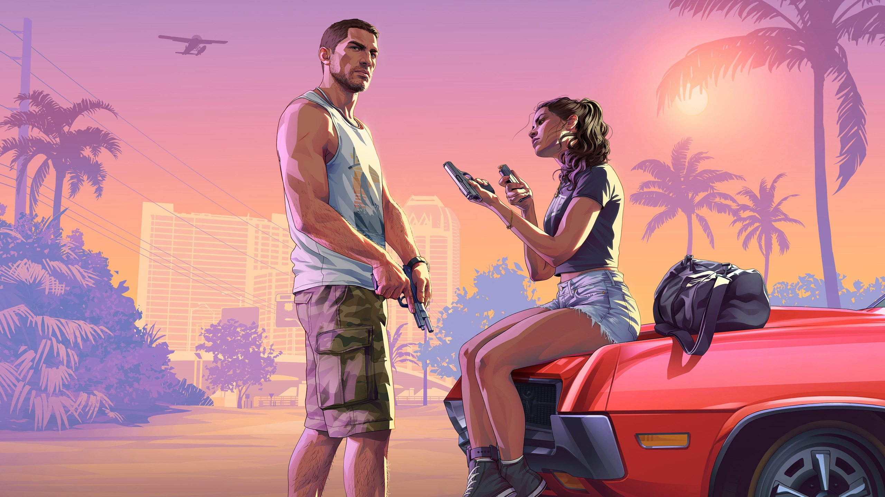

Rockstar Games hat den Launch-Trailer zu Grand Theft Auto VI veröffentlicht.
Das Video von 90 Sekunden ging am 15. Oktober um 15 Uhr online. Es zeigt neue
Szenen mit Jason und Lucia und bringt neue Musik von Justice.

Der Trailer ist unten und auf
der offiziellen Website zu sehen. Am frühen Abend hatte er auf YouTube
schon mehr als zwei Millionen Aufrufe. Laut Rockstar wurde alles im Spiel auf
einer PlayStation 5 aufgenommen.

<a href="https://www.youtube.com/watch?v=rz1B4B2yBZY">Grand Theft Auto VI Launch Trailer, Rockstar Games auf YouTube, 15. Oktober 2026</a>

## Die Vergangenheit von Jason

Der Trailer beginnt damit, dass Jason erzählt. Er hat in der Armee Ärger
bekommen und sie nicht im Guten verlassen, sagt Jason. Leuten wie ihm gebe
niemand einen Kredit, sagt er.

Danach poliert Jason in einem Jachthafen ein Boot, als ein Anruf kommt. Eine
Bandansage meldet einen kostenlosen Anruf von Lucia Caminos. IGN vermutet,
dass Jason nach diesem Anruf Lucia aus dem Gefängnis abholt.

Andere Einstellungen zeigen einen Soldaten, der mit einer Einheit durch
Wasser watet und aus einem Hubschrauber springt. Laut IGN könnten das
Rückblenden auf die Zeit von Jason in der Armee sein. Sie könnten aber auch
in der Gegenwart spielen, fügt IGN hinzu.

## Lucia, und die beiden zusammen

In einer Einstellung trägt Lucia eine Fußfessel, merkt IGN an. Der Trailer
zeigt auch romantische Szenen zwischen den beiden Hauptfiguren, schreibt
Tweakers. IGN erwähnt eine Szene unter der Dusche.

Gegen Ende fragt Lucia Jason, ob alles gut wird. Jason antwortet, dass sie
alles gemeinsam durchgestanden haben und es einfach durchstehen müssen.

Rockstar fasst die Geschichte in einem eigenen Text zusammen. Ein leichter
Coup geht schief, und Jason und Lucia geraten in eine kriminelle
Verschwörung, die sich über den ganzen Bundesstaat Leonida erstreckt. Sie
müssen sich aufeinander verlassen, um lebend herauszukommen.

## Action in ganz Vice City

Der Trailer zeigt mehr von Vice City und viel Action, so Tweakers. Zu sehen
sind kurz ein Banküberfall, Kämpfe mit der Polizei und Aufnahmen aus
Hubschraubern. In einer Szene hängt jemand an einer Last, die ein
Hubschrauber über die Stadt trägt, schreibt IGN.

IGN entdeckt außerdem einen Hund neben Jason bei einem Hubschrauberflug.
Eine Einstellung eines trainierenden Mannes zeigt laut IGN möglicherweise
das [System für Schweiß](/de/news/gta-vi-has-a-scripted-system-that-makes-its-characters-sweat/),
das Rockstar diese Woche beschrieben hat.

## Eine neue Single von Justice

Das Elektro-Duo Justice hat den Original-Score von Grand Theft Auto VI
komponiert, bestätigt Rockstar. Der Trailer verwendet eine neue Single des
Duos, "Flower in a Hurricane", mit Tame Impala, SZA und King Gizzard & The
Lizard Wizard.

Die Single ist auch auf
[Grand Theft Auto VI: The Album](/de/news/rockstar-announces-the-gta-vi-album-with-34-songs-on-cd-for-17-euro/)
zu finden, dem offiziellen Soundtrack. Rockstar verspricht bald mehr zur
Musik des Spiels, darunter ein offizielles Album mit dem Score.

## Was nicht bekannt ist

Der Trailer zeigt filmische Szenen und kein Gameplay, merkt IGN an. Ob es
der letzte Trailer vor dem Release ist, sagt Rockstar nicht. Welches Modell
der PlayStation 5 verwendet wurde, steht ebenfalls nicht dabei, und Bilder
von der Xbox Series X und S wurden noch nicht gezeigt.

Grand Theft Auto VI erscheint am 19. November für PlayStation 5 und Xbox
Series X und S. Der
[Preload beginnt am 12. November](/de/news/gta-vi-preload-starts-on-12-november-and-needs-free-space/).
