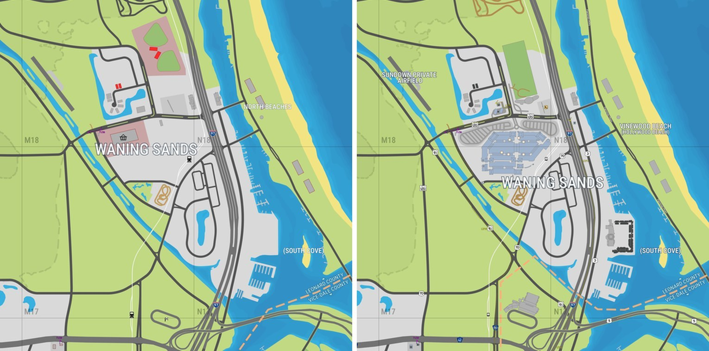
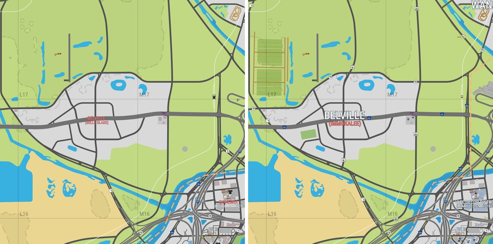
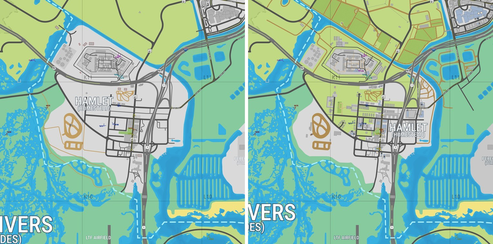

YANIS, the community map of Leonida, has a new version. Version 17 appeared on 17 October and draws many more buildings in Vice City. Hamlet and Waning Sands are redrawn, and farm fields appear for the first time. The [map on megamundo.be](/game/map/) now runs on v17.

YANIS is made by fans on map.stateofleonida.net. They piece the map together from the trailers, screenshots and other official material of Rockstar Games. The game itself is not out yet, so the map is an estimate and not an official map.

## More buildings in Vice City

The biggest change is in Vice City. Downtown, Little Cuba, Vice Beach and Starfish Island get many more buildings. Buildings in blue have an interior that has been seen in official material, according to the legend of the map. Grey buildings have no confirmed interior.

## Waning Sands and Belville

Waning Sands, north of Vice City, now has a large building complex with car parks next to the highway. The beach to its east is now called Vinewood Beach, after Hollywood Beach in Florida. A small airfield to the west gets the name Sundown Private Airfield.

<figure>

<figcaption>Waning Sands on YANIS v16 (left) and v17 (right), map.stateofleonida.net.</figcaption>
</figure>

The town of Belville, south-west of Waning Sands, is now linked to Immokalee in Florida instead of Belle Glade. Farm fields appear north of the town. They are a new terrain type in the legend, next to footpaths and dirt roads.

<figure>

<figcaption>Belville on YANIS v16 (left) and v17 (right), map.stateofleonida.net.</figcaption>
</figure>

## Hamlet

In the south, at the edge of Grassrivers, Hamlet is redrawn. The town now covers a smaller area further east, with more buildings. Farm fields and dirt roads lie to the north of it.

<figure>

<figcaption>Hamlet on YANIS v16 (left) and v17 (right), map.stateofleonida.net.</figcaption>
</figure>

The makers of YANIS did not publish a list of changes for v17. What is described here comes from comparing the two versions. The shape of the island and the borders of the [six regions](/game/map/) stay the same.
