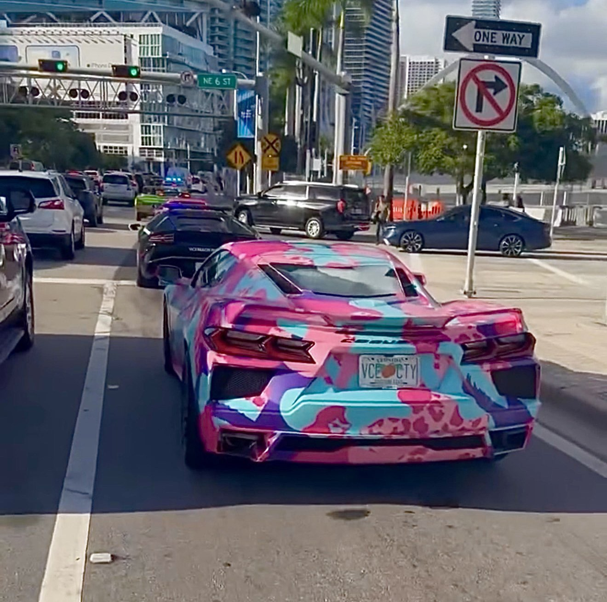
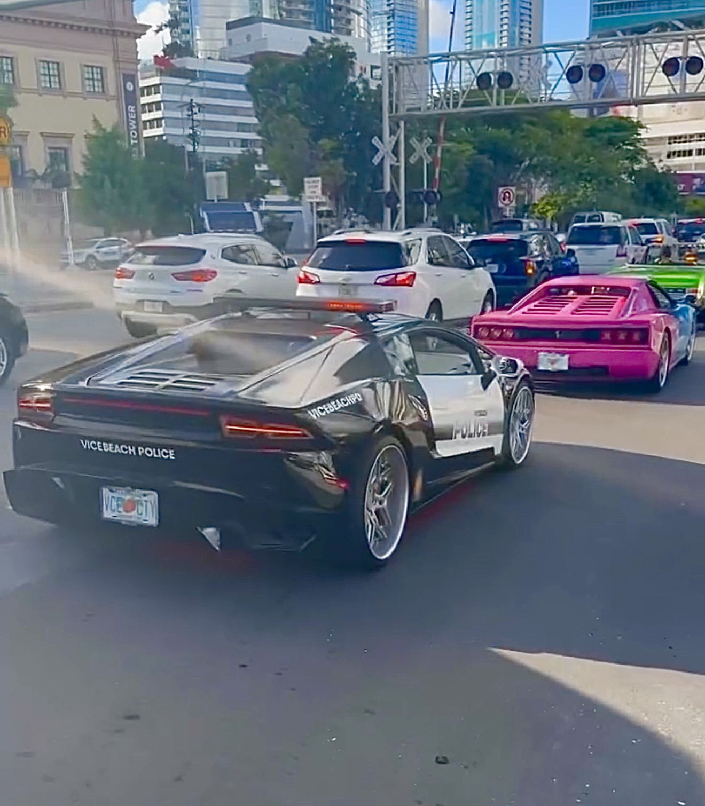

Auto vere travestite da veicoli di Grand Theft Auto VI hanno girato per Miami
questa settimana. Avevano targhe di Leonida. Tra loro c'era una Lamborghini
con i colori della polizia di Vice City, scrive IGN.

Secondo IGN, il convoglio fa parte del marketing di Rockstar Games per il
gioco a Miami.

## Quali auto

Le auto hanno viaggiato in fila stretta per la città, scrive IGN. Accanto alla
Lamborghini della polizia c'era una McLaren travestita da Progen Emerus.
Giravano anche versioni reali della Cheetah, della Coquette D10, della
Tempesta e della Manana.

La pagina di notizie locale Only in Dade ha visto alcune delle auto a una
stazione di servizio il 15 ottobre.

<blockquote class="twitter-tweet" data-dnt="true">

GTA was in full effect today 😤 #ONLYinDADE

<a href="https://twitter.com/ONLYinDADE/status/2110875001943736472">ONLY in DADE (@ONLYinDADE) su X, 15 ottobre 2026</a>

</blockquote>

In lontananza volava il dirigibile di Goodyear con una pubblicità di GTA VI,
secondo IGN. All'inizio della settimana quel dirigibile era
[ancora diretto a sud](/it/news/gta-vi-marketing-spreads-across-miami-as-county-officials-push-back/)
dall'Ohio.

L'account videotech su X ha condiviso le targhe e l'auto della polizia un
giorno dopo.

<blockquote class="twitter-tweet" data-dnt="true">

Rockstar Games appear to be marketing #GTAVI in Miami with a street car showcase, featuring Leonida licence plates and a VCPD-liveried Lamborghini 👀 Sources: / @WillMacGTA

<a href="https://twitter.com/videotech/status/2110898507448254774">ben (@videotech) su X, 16 ottobre 2026</a>

</blockquote>

Quel video viene da una storia di andrewblakeames su Instagram. Le foto
della stessa storia mostrano da vicino due delle auto. Le targhe riportano
VCE CTY. Sull'auto della polizia c'è scritto Vice Beach Police.

<figure>

<figcaption>Da una storia di andrewblakeames su Instagram, 15 ottobre 2026, condivisa da @GTASixInfo su X.</figcaption>
</figure>

<figure>

<figcaption>Da una storia di andrewblakeames su Instagram, 15 ottobre 2026, condivisa da @GTASixInfo su X.</figcaption>
</figure>

## Reazioni

Le reazioni sui social sono per lo più positive, scrive IGN. I giocatori
lodano la creatività della campagna. Un utente su X ha definito "FIRE" la
Lamborghini della polizia.

## Parte di una campagna più ampia

Il convoglio segue
[l'insegna sull'arena dei Miami Heat](/it/news/a-vice-city-sign-on-the-miami-heat-arena-costs-975000-dollar/),
le pubblicità nello stadio dei Dolphins e il dirigibile. Alcuni membri della
commissione di Miami-Dade County si oppongono alla campagna. La commissione si
riunisce di nuovo il 20 ottobre.

## Cosa non si sa

IGN non dice se Rockstar abbia confermato il convoglio. Quanto siano costate
le auto e se gireranno altrove non è noto. Grand Theft Auto VI esce il
19 novembre per PlayStation 5 e Xbox Series X e S.
